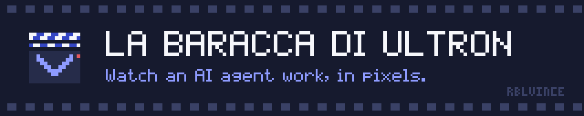
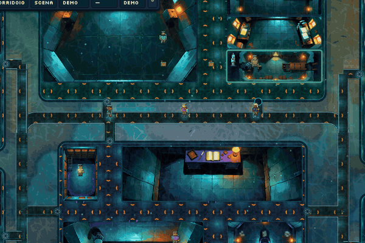
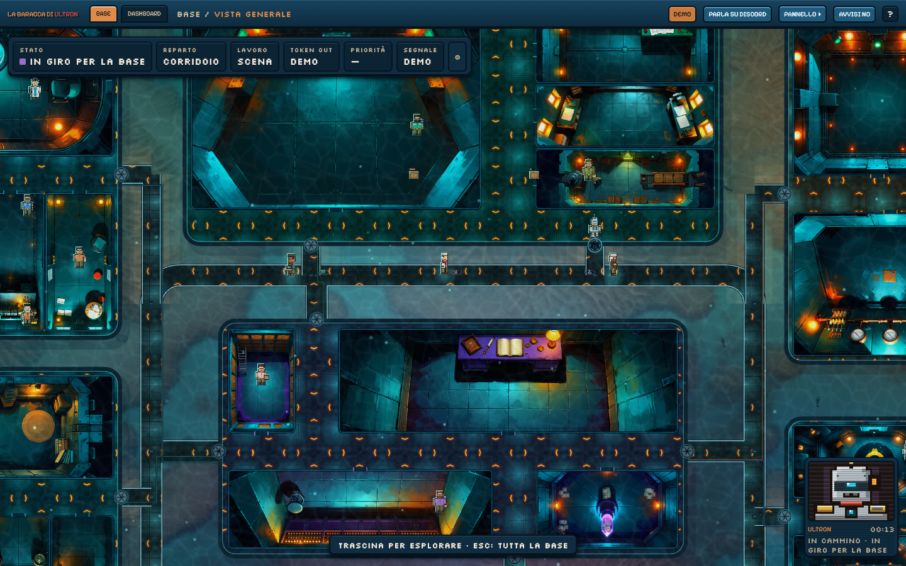
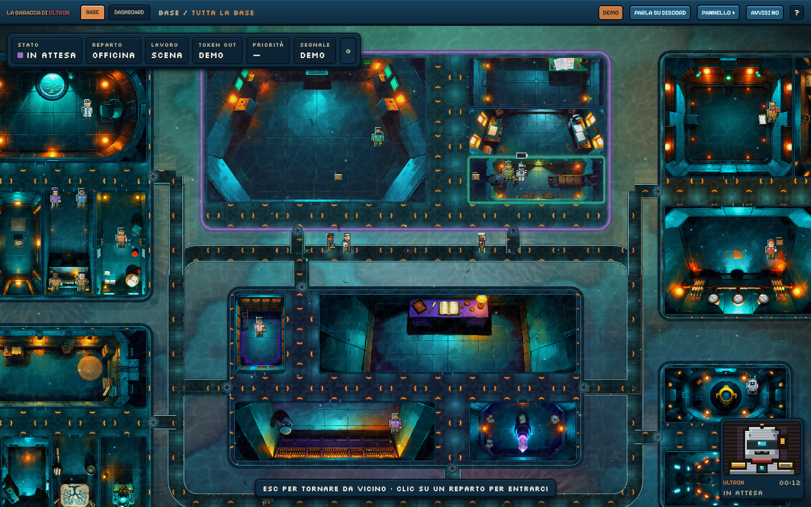

<p align="center">
  
</p>

<p align="center">
  
  
  
  
  
</p>

> **Logline.** An AI coding agent works in silence inside a terminal. La Baracca di Ultron turns
> that work into a living pixel-art base: every real event from a Claude Code session (a file
> read, a test run, a sub-agent sent off, a permission request) moves a crew of characters
> through the rooms, as it happens. Not a canned animation: the data is the session itself.
> The interface is in Italian.

## On screen


*Demo mode: Ultron walks the corridors carrying the missions; each department receives them at its post.*

| Close up | The whole base |
| --- | --- |
|  |  |

<sub>Screenshots in demo mode: no real session data.</sub>

## Cast

| Role | Technology |
|---|---|
| Scene | One HTML page on a `<canvas>`, vanilla JavaScript, no dependencies |
| Bridge | Python scripts called by eight Claude Code hooks (`PreToolUse`, `PostToolUse`, `SubagentStop`, `UserPromptSubmit`, `Stop`, `Notification`, `PreCompact`, `SessionStart`) |
| Server | Python standard library only, Server-Sent Events to the page, polling as a fallback |
| History panels | A React 19 island (Vite, TypeScript, Vitest), shipped as a single prebuilt file |
| Data (optional) | Supabase: events, sessions, sub-agents and token costs, with SQL migrations |

## Behind the scenes

- **Real events only.** The hooks write what the session actually did; the page draws it. When
  nothing is happening the base rests, dims its lights and, after a while, goes to sleep.
- **Who walks carries something.** Only Ultron, the clones of other terminals and the sub-agents
  move; the twelve crew members keep a fixed post and act from there. Motion always means work
  moving from one place to another.
- **Sub-agents get a face.** Three sub-agent types (`coder`, `valutatore`, `jev-giuria`) have
  their own character, who collects the sealed order, works in their department and brings the
  report back. Every other type becomes a mini-Ultron, so the count on screen stays true.
- **Skills are specialists.** The installed skills (folders with a `SKILL.md`) appear as
  specialists in the lab; when the agent uses one, its specialist throws it the tool.
- **No build step to run it.** The scene is plain JavaScript and the server is stdlib Python; the
  React panels are committed prebuilt, so the base starts without Node.
- **One home for the timings.** Idle, live and sub-agent thresholds live in `hooks/soglie.py`
  and reach the page through `/api/config`, so server and scene never disagree.
- **Local by design.** It listens on `127.0.0.1` only and is never published; runtime state stays
  out of the repository.

## Shoot it yourself

Requirements: macOS, Python 3, Google Chrome and Claude Code.

```sh
./start.sh   # server on :8795, the page in Chrome, a Claude Code session in Terminal
```

Without a session the page opens in demo mode. To see your own work, register the hooks in
Claude Code's `settings.json`: the exact entries, the characters and the controls (drag, scroll,
`ESC` for the whole base, `U` to follow Ultron) are in the [Italian guide](docs/guida.md).
Supabase is optional; its migrations are in `supabase/migrations/`, applied in order.

## Dailies

```sh
./run_tests.sh
```

13 suites in one command: the hooks and the server (five Python suites), the pure logic of the
scene (six Node suites: dashboard, layout, crew positions, sub-agents), and the React panels (80
Vitest tests plus a type-check). It exits with 1 if any of them fails.

## Credits

Written and directed by **Vincent** ([@rblvince](https://github.com/rblvince)), built with
Claude Code as an AI pair programmer. Claude Code is a product of Anthropic.

Released under the [MIT License](LICENSE).

<p align="center"></p>
